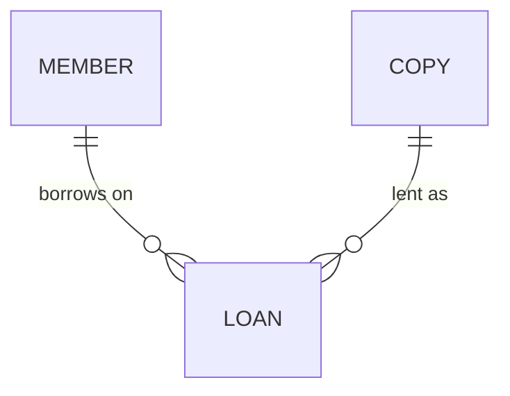
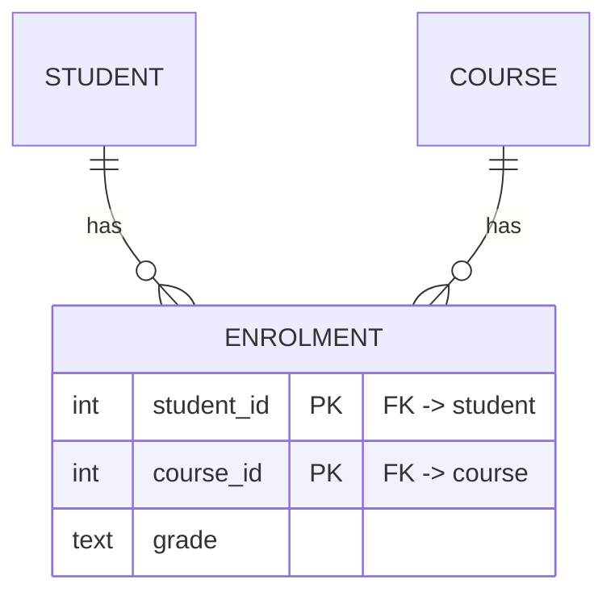
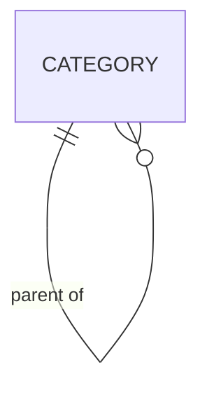
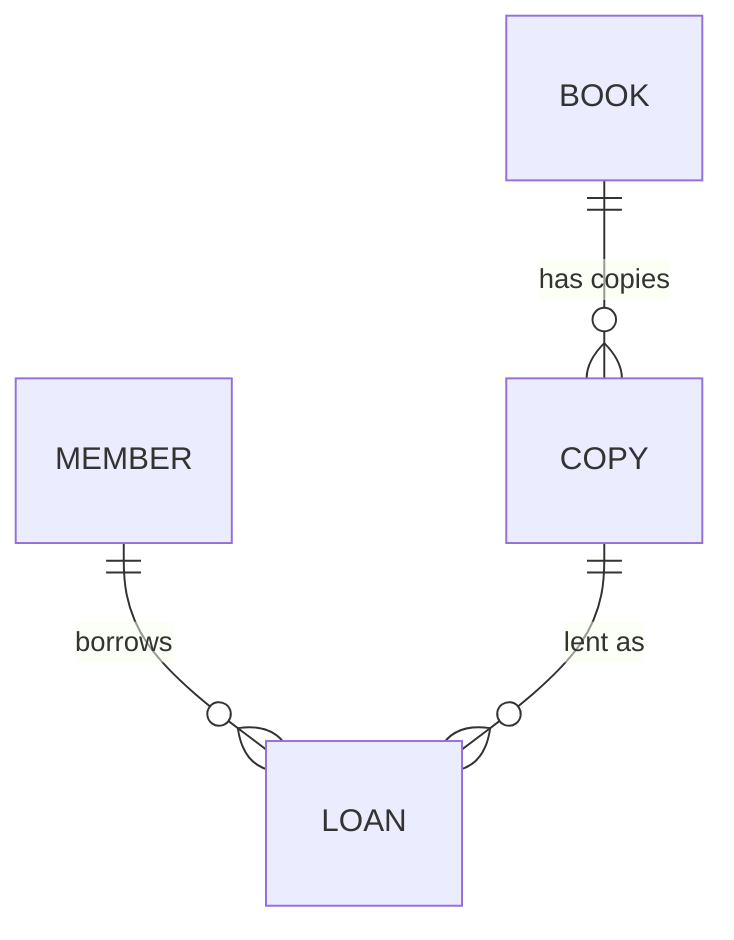

<!--
  DATABASE DESIGN - REVISED LESSON (corrected edition)
  Format: Markdown. To make a PDF, convert with any Markdown->PDF tool.
  ER diagrams are written as ```mermaid erDiagram``` blocks; render them with a
  Mermaid-capable renderer (most Markdown->PDF pipelines and browsers support it).
-->

# Database Design — The Revised Lesson

*A corrected, self-contained lesson in entity–relationship (ER) design, from scratch, on paper.*

> **About this edition — please read.** This is the corrected "lesson" file you
> asked for. Two honest notes about how it was made:
>
> 1. The original lesson arrived as a Word (`.docx`) file. In the environment I
>    am running in, I could not open that Word file to edit its exact prose. So
>    this revised lesson is built from the material I *could* read in full — the
>    design primer I wrote for you, plus every example and table from the
>    companion **samples** file (which I read page by page) — with all of the
>    Task‑2 corrections applied. It covers the same ground as the original
>    notebook, lesson for lesson, and it is safe to study as your main lesson.
> 2. The original notebook ended with ten practice questions *and their
>    answers*. I could not read those answers, so I could not check them.
>    Instead, this edition ends with a **fresh set of ten practice questions
>    with worked answers that I have verified myself** (Part 13).
>
> Everything below marked **[correction]** is a change made because of the
> Task‑2 review. The full review lives in `database-design-AI-pieces-review.txt`.

---

## How to read this lesson

Four signposts recur, exactly as in the primer:

- **CONTEMPLATE** — stop and think before reading on. No rush.
- **TRY IT** — a small thing to do on paper.
- **KEY IDEA** — the one sentence to remember.
- **PITFALL** — a common mistake, named so you can avoid it.

This whole lesson is paper work. You do not touch a computer here. The
touching‑a‑computer work is in `database-design-practice-lesson.txt`.

## Part 1 — What "designing a database" actually means

Before any detail, the big picture. **Designing a database means deciding what
things you will keep, what facts you will keep about each, and how those things
connect — all before you store a single row.** The design is a blueprint. The
rows that flow in later are the data. A good blueprint makes the data behave; a
poor one fights you forever.

Designers work at three levels, from fuzzy to concrete:

- **Conceptual** — the things and their connections, in plain language. "We have
  students, groups, parameters, and scores; a score is about a student and a
  parameter." No tables yet. This is where most of the thinking happens.
- **Logical** — the same picture turned into tables, columns, keys, and foreign
  keys, but not tied to any particular database product.
- **Physical** — the real `CREATE TABLE` statements for a specific database
  (Postgres, SQLite, …), with exact types and indexes.

**KEY IDEA:** design top‑down. Get the conceptual picture right on paper first;
the logical and physical levels are mostly careful translation after that.

A design is **good** when it is:

- **faithful** — it matches how the real world actually behaves;
- **non‑redundant** — each fact is stored once, in one place;
- **answerable** — it can answer the questions you need to ask of it;
- **simple** — no more tables or columns than the job requires.

**CONTEMPLATE:** of those four, "answerable" is the quiet one. Before designing
anything, write down the *questions* and *actions* the system must support —
"who scored below 50 last term?", "add a student to a group", "show a group's
average over time". A design that cannot answer its own purpose questions is
wrong no matter how tidy it looks. We will return to this list at the very end
(Part 9, step 10) to check our work against it.

## Part 2 — Entities: the "things" (type vs instance)

An **entity** is a thing you keep information about: a student, a book, a group,
a score. Each entity type becomes a **table**. The single most important
distinction for a beginner:

- an entity **type** is the *kind* of thing — it becomes a **table** (the
  cookie‑cutter);
- an entity **instance** is *one* of them — it becomes a **row** (one cookie).

So "student" the table is the kind; each enrolled person is a row.

**How to find entities:** write a sentence or two describing your world, then
**underline the nouns.** Most strong, repeated nouns are entities; the facts
hanging off them are attributes (Part 3); the verbs between them are
relationships (Part 4). "A **student** belongs to a **group** and receives a
**score** on each **parameter** every **period**" → five candidate entities.

**PITFALL:** not every noun is an entity. Some are just attributes ("name",
"colour"), and some are relationships in disguise ("enrolment", "loan"). The
test, used again and again: *do we keep facts about this thing, or will many
rows share it?* If yes, it earns its own table; if it is a single plain value
belonging to one row, it is an attribute.

## Part 3 — Attributes: the facts about each thing

An **attribute** is one fact kept about an entity; it becomes a **column**.
Attributes come in kinds you must recognise:

- **atomic** vs **composite** — a composite attribute has parts worth splitting.
  "Full name" may split into given/family name; an address splits into
  street/city/postcode. Split when you will query or sort by the parts.
- **single‑valued** vs **multi‑valued** — a person has one birth date
  (single), but possibly many phone numbers (multi). **A multi‑valued attribute
  is never many columns and never a list in one cell — it becomes its own table
  with a foreign key back** (Part 7).
- **stored** vs **derived** — a derived value can be computed from others. Store
  `birth_date`, show *age*. Store the line items, compute the *total*. The rule
  is **derive, don't store**, because a stored copy drifts out of step with what
  it came from.

**[correction] The frozen‑fact exception.** There is one important exception the
samples file makes well and the primer only hinted at: a value you capture **on
purpose, at a moment in time, because it must never change afterward** is *not* a
derived value you should drop — it is a **frozen fact**. The classic case is
`unit_price_at_sale` on an order line: the product's price today is irrelevant;
the order must remember what the customer actually paid. Keep it. It only
*looks* like redundancy.

**KEY IDEA:** derive values you can always recompute; freeze values that record
"what was true at the time". In student‑panel, a recorded score is a frozen fact
of its period — once scored, the number stands even if the parameter is later
reconfigured.

## Part 4 — Relationships, cardinality, and participation

A **relationship** is how two entities connect — usually a verb. "A student
*belongs to* a group." "A member *borrows* a copy." Two measurements make a
relationship precise, and you must state **both**:

**Cardinality** — how many on each side:

- **one‑to‑one (1:1)** — one country has one capital.
- **one‑to‑many (1:N)** — one group has many students; each student is in one
  group.
- **many‑to‑many (M:N)** — a student takes many courses; a course has many
  students. (M:N always needs a table in the middle — Part 7.)

**Participation** — whether a side is **optional** (minimum zero) or
**mandatory** (minimum one). "Must every loan have a member? Yes (mandatory).
Must every member have a loan? No (optional — a brand‑new member has none)." The
optional side is exactly where a **NULL** or a *zero‑count* is allowed and
meaningful.

**TRY IT:** for any two entities, say the pairing aloud **in both directions**
with a number and an optionality each time: "one group has *zero or many*
students; one student has *exactly one* group." If you can say both sentences,
you have the relationship fully specified.

**KEY IDEA:** every relationship = a direction + a number (one/many) + an
optionality (zero/one minimum), stated **both ways**. Skip either and the design
is ambiguous.

## Part 5 — Keys: how a row is identified and how tables point at each other

A **key** is a column (or set of columns) that identifies a row.

- **candidate key** — any column(s) that could uniquely identify a row.
- **primary key (PK)** — the one candidate key you choose as *the* identifier.
- **natural key** — a real‑world identifier (email, ISBN, national id).
- **surrogate key** — an id invented by the system purely to be a stable handle.

Natural keys change and sometimes repeat; surrogate keys never do. **Modern
practice: give each table a surrogate primary key, and *also* keep the useful
natural value under a `UNIQUE` rule** so it still cannot duplicate.

**[correction] Two kinds of surrogate key — INT and UUID.** This is the one real
addition the Task‑2 review called for. A surrogate key can be:

- an **auto‑numbered integer** (1, 2, 3, …) — small, readable, perfect for
  learning. The samples file uses these everywhere.
- a **UUID** — a long random id like `7f3a1c2e‑…‑9c2b`. Better when ids must be
  unique across many machines, or must not reveal how many rows exist or in what
  order they were created.

Both are surrogate keys; neither is "more correct". **student‑panel uses UUID
primary keys plus a unique human `student_code`.** So when you see `1, 2, 3` in
the samples and long random ids in student‑panel, that is the *same decision in
two costumes* — not a conflict.

Continuing with keys:

- **composite key** — a key made of more than one column (e.g. a bridge table
  keyed on `(student_id, course_id)`).
- **foreign key (FK)** — a column that points at another table's primary key.
  This is how tables connect. The FK carries a promise the database enforces:
  "this pointer must point at a row that really exists" — called **referential
  integrity**. A row that points at something gone is an **orphan**, and the FK
  refuses to create one.

**Where the FK goes:** in a one‑to‑many, **the foreign key lives on the MANY
side.** One group, many students → the *student* row carries `group_id`, not the
other way around. The child points at the parent.

**For a 1:1**, put the FK on the side that is **never empty**, and mark it
`UNIQUE NOT NULL` (one passport belongs to exactly one person → put `person_id`
on the passport row).

**ON DELETE rules** — when a parent row is deleted, each FK decides what happens:

- **RESTRICT** — refuse the delete while children exist (protect history).
- **CASCADE** — delete the children too (they cannot exist without the parent).
- **SET NULL** — keep the children but blank the pointer (the link was optional).

A good habit from the samples file: **say each delete rule as a sentence** — "you
may not delete a member who still has loans" (RESTRICT), "deleting an order
deletes its order lines" (CASCADE).

**[correction] Reserved words.** At the physical level, some words already mean
something to the database — `order`, `group`, `user` are reserved in Postgres
(which student‑panel uses). Do not name tables or columns with them directly;
use `orders`, `groups`, `app_user`, or quote them. The primer never mentioned
this; the samples file flags it, and it matters.

## Part 6 — Reading and drawing crow's‑foot diagrams

A relationship is drawn as a line between two tables. Near each end are up to two
marks: the mark **closest** to the table is the **maximum** (one, or many); the
mark just before it is the **minimum** (zero = optional, or one = mandatory).

| Symbol | Reads as |
|---|---|
| `\|` (bar) | one |
| `o` (circle) | zero / optional |
| `<` (crow's foot) | many |
| `\|\|` | one and only one (min 1, max 1) |
| `\|<` | one or many (min 1, max many) |
| `o<` | zero or many (min 0, max many) |
| `o\|` | zero or one (min 0, max 1) |

**[correction] The mirroring.** Read the marks from the **outside in** toward
each table. Because the two ends face the line from opposite sides, the *same*
meaning is drawn mirrored: "zero or many" is `o<` on the left end and `>o` on the
right end. They are identical — do not read `>o` and `o<` as two different ideas.
The primer used this convention without explaining it; here it is explicit.

A worked reading — the library line:

```
Member  ||-----o<  Loan  >o-----||  Copy
```

- Member side: `||` next to Member = exactly one member; `o<` next to Loan =
  zero or many loans → "one member has zero or many loans; each loan belongs to
  exactly one member."
- Copy side: `>o` next to Loan (mirrored `o<`) = zero or many loans; `||` next to
  Copy = exactly one copy → "one copy has zero or many loans; each loan is of
  exactly one copy."

The same picture as a Mermaid diagram (renders when converted with a
Mermaid‑capable tool):



**TRY IT:** cover the captions in the samples file, read the symbols aloud as
full sentences, and check your sentence against the caption. If they match, you
can read crow's‑foot.

## Part 7 — The five hard patterns (and the one move behind three of them)

Most designs are easy until you hit one of five shapes. Learn to recognise them.

**7.1 Many‑to‑many → a bridge table.** A student takes many courses; a course has
many students. You cannot express M:N with a single FK. Put a **bridge**
(junction/associative) table in the middle, carrying one FK to each side:



Any fact *about the pairing* (a grade, a date) lives **on the bridge**, not on
either side.

**[correction] Choosing the bridge's key.** Two valid styles:

- **pair as the key** — `PRIMARY KEY (student_id, course_id)`. Use this when the
  pairing is naturally unique and nothing else needs to point at the bridge row.
- **a surrogate id on the bridge** — `enrolment_id` as PK, **plus a `UNIQUE`
  constraint on the pair**. Use this when some *other* table must reference an
  individual bridge row. If you take this route, do not forget the `UNIQUE` on
  the pair, or you silently allow duplicate pairings.

Decide on purpose; both are correct. (The samples file shows both; this note
makes the "when" explicit.)

**7.2 One‑to‑one → usually merge.** If two tables are 1:1, ask whether they
should just be one table. Keep them separate only for a reason: optional data
kept apart, security, or very wide rows. When separate, FK on the never‑empty
side, `UNIQUE NOT NULL`.

**7.3 Self‑reference (a tree).** A thing that contains more of its own kind — a
group inside a group, a category with sub‑categories, an employee with a
manager. Add **one column that points back at the same table** (`parent_id`),
`NULL` at the root. One column handles any depth; the cost is that "all
descendants" needs a recursive query. Do **not** use `parent`, `grandparent`,
`great_grandparent` columns — that caps the depth and repeats the "repeating
columns" mistake.



**student‑panel uses this twice** — groups form a tree and parameters form a
tree, each with a self‑referencing parent and `NULL` at the root.

**7.4 Weak / dependent entity.** Something that cannot exist without its parent
and is identified partly by it — an order *line* only means something inside its
order. Its key often includes the parent's key, and its delete rule is usually
CASCADE.

**7.5 Ternary (a three‑way fact).** Sometimes a fact genuinely joins **three**
things at once: a *prescription* ties a doctor, a drug, and a patient; a
*supply* ties a supplier, a part, and a project. Model it as a table in the
middle holding all three FKs.

**[correction] The UNIQUE‑on‑the‑triple note.** If you give such a table its own
surrogate id (`prescription_id`), you must still **decide whether the natural
combination should be `UNIQUE`** — exactly the decision the samples file states
for the order‑line bridge but leaves unsaid for the prescription. Sometimes the
triple *should* be unique; sometimes the real world allows repeats (the same
doctor may prescribe the same drug to the same patient again on a later date, in
which case a date belongs in the key and the triple is deliberately *not*
unique). Make the choice consciously and write it down.

**The one move.** Notice that 7.1 (many‑to‑many), "a link that has its own
facts", and 7.5 (a three‑way fact) are the **same move**: when a relationship is
many‑to‑many, *or* carries its own attributes, *or* joins more than two things,
it stops being a line and **becomes a table**. The **disguise test** for a
ternary (from the samples file): drop one of the three nouns — if the remaining
sentence is still a complete, real fact, it was not truly a three‑way fact.

**KEY IDEA:** if a relationship is M:N, has its own facts, or joins 3+ things, it
wants to *be* a table, not a line. In student‑panel, the **scores/evaluations**
table is exactly this — a table in the middle linking a student and a parameter
(for a period) and carrying the score. The thing that looks like "just a link"
is the most important table in the design.

## Part 8 — Normalisation: removing the anomalies

Normalisation is a set of checks that remove duplication. Duplication causes
three **anomalies**:

- **update anomaly** — a fact copied onto many rows drifts apart when one copy
  changes (rename a member whose name was copied onto every loan, and the loans
  disagree).
- **insert anomaly** — you cannot record a thing because there is nowhere to put
  it (a member who has not borrowed anything yet has no row in a loan‑only
  table).
- **delete anomaly** — removing one row destroys an unrelated fact (deleting a
  member's last loan erases the member entirely).

**[correction] What "depends on" means** (a beginner‑friendly definition from the
samples file): *A depends on B when knowing B tells you A.* If you know the
`member_id`, you know the member's name — the name **depends on** the member id.
This single idea powers the normal forms.

The three forms you need, with the classic mnemonic — *every non‑key column must
depend on **the key, the whole key, and nothing but the key**:*

- **1NF — the key.** One value per cell; no repeating columns (`phone1`,
  `phone2`, `phone3`) and no lists stuffed in a cell. Repeating things get their
  own table (Part 7). A list in a cell cannot be searched or counted.
- **2NF — the whole key.** With a composite key, no column may depend on only
  *part* of it. On `order_line(order_id, product_id)`, `product_name` depends on
  `product_id` alone → it belongs in a `product` table, not on the line.
- **3NF — nothing but the key.** No column may depend on another non‑key column.
  If `employee` stores `dept_id` *and* `dept_name`, the name depends on
  `dept_id`, not on the employee → move it to a `dept` table.

**Deliberate denormalisation.** Sometimes you store a redundant value on purpose
for speed, accepting the upkeep cost — a conscious trade, not an accident.

**[correction] Not a break: the frozen fact.** `unit_price_at_sale` on an order
line looks like it violates normalisation, but it does not: it is a historical
value captured at sale time, not a copy of the product's current price. Keeping
it is correct (see Part 3). Recognising the difference between a *drifting copy*
(bad) and a *frozen record* (good) is a real design skill.

## Part 9 — The design method (one merged ten‑step routine)

**[correction] Unifying the two lists.** You have seen two ten‑step routines: the
primer's Part 7, and the samples file's Lesson 15. They are the *same method*
sliced differently, and the samples file itself invites you to compare them.
Here is a single merged routine that keeps the best of both — it keeps the
primer's explicit **"draw it"** step, and it promotes the samples file's
**"questions/actions"** and **"delete rules"** to steps of their own so a
beginner cannot skip them:

1. **State the purpose** — one or two sentences on what the system is for.
2. **List the questions and actions** it must support (the "answerable" test).
3. **Find the entities** — underline the nouns; each becomes a table.
4. **Find the attributes** — mark composite / multi‑valued / derived.
5. **Choose keys** — a surrogate PK (INT or UUID), plus `UNIQUE` on natural keys.
6. **Find the relationships** — state cardinality **both ways** + participation
   ("say the pairs aloud").
7. **Resolve the hard patterns** — M:N → bridge, ternary → middle table,
   self‑reference → `parent_id`, weak entity, 1:1.
8. **Place the foreign keys** — FK on the many side; 1:1 on the never‑empty side.
9. **Choose the delete rules** — RESTRICT / CASCADE / SET NULL, said as
   sentences.
10. **Draw it** — a crow's‑foot diagram, so the shape is visible.
11. **Normalise** — check 1NF, 2NF, 3NF; remove the anomalies.
12. **Map to tables** — write the `CREATE TABLE`s.
13. **Test with rows** — put a few real rows in and answer the Step‑2 questions.

(That is the two lists merged; both the primer and the samples file "arrive" at
this same place — nothing is lost, and the two skippable steps are now explicit.)

**KEY IDEA:** the method is a loop, not a straight line. Testing with rows
(step 13) often sends you back to step 3. That is normal and healthy.

## Part 10 — A worked example, end to end: a small library

Follow the merged method on a real little problem.

**1. Purpose.** Track which members borrow which copies of which books, and when
they are due back.

**2. Questions/actions.** Who has book X out right now? What is overdue? How many
loans has a member had? Add a member; lend a copy; record a return.

**3. Entities.** Nouns: **member**, **book**, **copy**, **loan**. (A *book* is
the title; a *copy* is one physical item of it — the library owns three copies
of one book.)

**4. Attributes.** member: name, email, joined date. book: title, author, isbn.
copy: shelf code, acquired date. loan: borrowed/due/returned dates.

**5. Keys.** Surrogate PK on each (`member_id`, `book_id`, `copy_id`,
`loan_id`); `email` and `isbn` kept `UNIQUE` as natural keys.

**6. Relationships.** One book has many copies; each copy is of one book
(1:N). One member has many loans; each loan is one member's (1:N). One copy has
many loans over time; each loan is of one copy (1:N). A loan therefore ties one
member to one copy.

**7. Hard patterns.** None heavy here: "a member borrows many books" *looks*
M:N, but the **loan** is the bridge that resolves it, and it carries its own
facts (the dates) — the "one move" in action.

**8–9. FKs and delete rules.** `copy.book_id` → book (RESTRICT: don't delete a
book that still has copies). `loan.copy_id` → copy and `loan.member_id` → member
(RESTRICT: keep loan history).

**10. Diagram.**



**11–12. Normalise and map to tables.** Each fact sits once; no repeating
columns; `returned_on` is `NULL` until the item comes back (a meaningful NULL):

```sql
member(member_id PK, given_name, family_name, email UNIQUE, joined_on)
book(book_id PK, title, author, isbn UNIQUE)
copy(copy_id PK, book_id FK -> book, shelf_code, acquired_on)
loan(loan_id PK, copy_id FK -> copy, member_id FK -> member,
     borrowed_on, due_on, returned_on NULL)
```

**13. Test with rows.** "Who has book X out now?" → loans where the copy's
`book_id` = X and `returned_on IS NULL`, joined to member. The design answers the
Step‑2 questions cleanly, so it is sound.

## Part 11 — Design judgement (the choices with no single right answer)

Rules take you far; judgement takes you the rest of the way. The recurring
calls:

- **Derive vs store** — recompute what you can; freeze what records a moment
  (Part 3). Denormalise only on purpose, for a measured reason.
- **The meaning of NULL** — decide, per column, whether blank is legal and what
  it *means*. `returned_on IS NULL` = "still out". Forbid NULL (`NOT NULL`) where
  blank would be nonsense.
- **Soft vs hard delete** — a **hard** delete removes the row for good; a
  **soft** delete keeps it but marks it (an `archived_at` date or `is_active`
  flag) so attached history survives. Choose by whether you ever need the past
  back. **student‑panel soft‑deletes / archives** so past scores stay
  meaningful.
- **A flexible/JSON column vs real columns** — a single "extra data" blob is
  tempting but cannot be constrained, validated, or queried like real columns.
  Prefer real columns for anything you will search or guard; reserve flex
  columns for genuinely open‑ended extras.
- **Naming** — be consistent: singular table names or plural, `snake_case`,
  `*_id` for keys. Avoid reserved words (`order`, `group`, `user`). Consistency
  beats cleverness.

## Part 12 — How this maps to student‑panel (and where your way may differ)

As we re‑derive student‑panel together, you will recognise these shapes:

- **Surrogate keys** → UUID PKs + a unique `student_code` (Part 5's INT‑vs‑UUID
  note).
- **The bridge / "one move"** → the scores/evaluations table in the middle.
- **Self‑reference trees** → groups and parameters, each with `parent_id`.
- **Frozen facts** → a recorded score stands for its period.
- **Soft delete** → archive instead of erase.

**Our standing rule:** we do **not** change the student‑panel project. You build
your own version in `student‑panel‑I`, and wherever your way differs from
student‑panel's way, I will say so. Two differences are already visible: ids
(you may use INT while learning; student‑panel uses UUID) and deletes (you may
hard‑delete while practising; student‑panel soft‑deletes).

> **One thing to confirm against the real database.** The exact keys and columns
> of student‑panel's own tables should always be checked against the live schema
> before you rely on them — do not trust any lesson (including this one) for the
> precise column names. We will inspect the real schema together when we get
> there.

## Part 13 — Ten practice questions, with verified answers

These are a fresh set, written and checked for this edition (they replace the
original notebook's ten questions, whose answer key I could not open to verify).
Try each on paper **before** reading the answer.

**Q1. Entity or attribute?** In a tiny corner shop, is *colour* an entity or an
attribute? In a large paint manufacturer?
**A1.** Purpose decides. In the corner shop, `colour` is just a plain value on a
product → an **attribute** (a column). In the paint manufacturer, colours have
their own facts (code, base, supplier) and many products share them → an
**entity** (its own `colour` table, referenced by FK). Same word, different role.

**Q2. Type vs instance.** "Student" — one thing or many?
**A2.** `student` the **table** is the type (the kind). Each enrolled person is a
**row** (an instance). You design the type; the rows arrive later.

**Q3. Many phone numbers.** A member may have several phones. Give the design,
and say why not `phone1, phone2, phone3`.
**A3.** A member *has many* phones (1:N), so phones get their **own table** with
the FK on the many side:
`member(member_id PK, full_name)` and
`phone(phone_id PK, member_id FK -> member, number)`.
`phone1/2/3` caps the count and breaks 1NF; queries like "who has number X?"
would have to name every column.

**Q4. Cardinality both ways.** A group has many students; a student is in one
group. State the relationship with numbers *and* participation, both ways.
**A4.** "One group has **zero or many** students" (a brand‑new group may have
none → optional). "One student has **exactly one** group" (mandatory). That is
1:N, student side mandatory, group side optional.

**Q5. FK placement.** For Q4, which table carries `group_id`?
**A5.** The **student** table (the many side). One group → many students, so the
pointer lives on each student row, not on the group.

**Q6. M:N with a fact.** Students take many courses; a course has many students;
each pairing has a *grade*. Design it. Where does `grade` go, and what is the key?
**A6.** M:N → a table in the middle. The grade is a fact *about the pairing*, so
it lives on the bridge:
`student(student_id PK, ...)`, `course(course_id PK, ...)`,
`enrolment(student_id FK, course_id FK, grade, PRIMARY KEY(student_id, course_id))`.
The composite `(student_id, course_id)` is the key — it also stops the same
student being enrolled in the same course twice. **[correction applied]** If you
instead gave `enrolment` its own surrogate id, you would still add
`UNIQUE(student_id, course_id)` on purpose — unless the real world allows a
repeat (e.g. retaking a course in a later term, in which case a term column joins
the key).

**Q7. Self-reference tree.** Categories can sit inside categories. Give the
design and say what `parent_id IS NULL` means.
**A7.** One table pointing at itself:
`category(category_id PK, name, parent_id FK -> category NULL)`.
`parent_id IS NULL` marks a **top-level** category (a root with no parent). Do
**not** use `parent, grandparent, ...` columns — that caps the depth.

**Q8. Which normal form is broken?** A table is
`loan(loan_id PK, member_id, member_name, member_email, book_title)`.
What is wrong, which rule names it, and what is the fix?
**A8.** `member_name` and `member_email` depend on `member_id`, not on the whole
key `loan_id` — a fact about the member has leaked into the loan row (update
anomaly: change an email in one loan, the others still lie). That violates **3NF**
("nothing but the key"). Fix: move member facts to a `member` table and keep only
`member_id` (FK) on `loan`.

**Q9. Store it or derive it?** (a) An order's *total* = sum of its lines. (b) The
*unit price at the moment of sale*. Store which, and why?
**A9.** (a) **Derive** the total — it is recomputable from the lines, so storing
it risks drift. (b) **Store** `unit_price_at_sale` **[correction applied]** — it
is a *frozen historical fact*: the price the customer actually paid, which must
not change when the catalogue price changes later. "Derive, don't store" applies
to values you can always recompute; a captured point-in-time value is the
exception.

**Q10. Read the diagram aloud.** What does `member ||--o{ loan` say, in both
directions?
**A10.** Left→right: "one member has **zero or many** loans" (`||` = exactly one
on the member end; `o{` = zero-or-many on the loan end). Right→left: "each loan
belongs to **exactly one** member." A new member with no loans is allowed; a loan
with no member is not.

---

## Glossary

- **Attribute** — a property of an entity; becomes a **column**.
- **Candidate key** — any column(s) that could uniquely identify a row.
- **Cardinality** — how many on each side of a relationship (1:1, 1:N, M:N).
- **Composite key** — a key made of more than one column.
- **Conceptual / logical / physical** — the three design levels: ideas → tables &
  keys → the actual SQL types and constraints in a specific engine.
- **Crow's-foot** — the diagram notation: `|` one, `o` zero/optional, `{` many.
- **Derived value** — a value computable from others; prefer not to store it.
- **Entity** — a kind of thing worth its own table; a **type**. A single one is an
  **instance** (a **row**).
- **Foreign key (FK)** — a column pointing at another table's primary key; it sits
  on the **many** side.
- **Frozen fact** — a value captured on purpose at a moment in time (e.g.
  `unit_price_at_sale`); kept, not re-derived.
- **Normalisation (1NF/2NF/3NF)** — removing redundancy so each fact lives once:
  "the key, the whole key, and nothing but the key."
- **NULL** — "no value here"; on an FK it means the optional link is absent.
- **ON DELETE RESTRICT / CASCADE / SET NULL** — what happens to children when a
  parent row is deleted: block it / delete them too / blank their FK.
- **Participation** — whether a side is mandatory (min one) or optional (min zero).
- **Primary key (PK)** — the one chosen candidate key that identifies each row.
- **Referential integrity** — the rule that every FK must point at a row that
  exists (no orphans).
- **Relationship** — a verb linking entities ("a member *borrows* a copy").
- **Surrogate key** — a system-made id with no business meaning: an auto-number
  **INT**, or a **UUID** (student-panel uses a UUID PK plus a unique human code).
- **Natural key** — a key made of real-world data (e.g. an ISBN).
- **Weak entity** — one that cannot be identified without its parent.

---

*End of the revised lesson. Companion files: the samples/examples live in
`database-design-revised-samples.md`; the hands-on practice in
`database-design-practice-lesson.txt`; the concept bridge in
`database-design-companion-lesson.txt`; and the review of the other-AI pieces in
`database-design-AI-pieces-review.txt`.*
