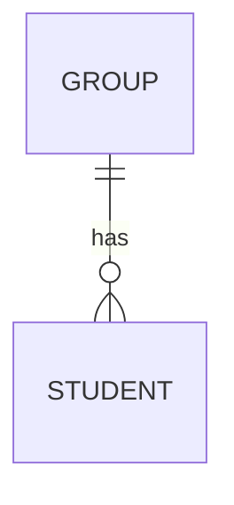
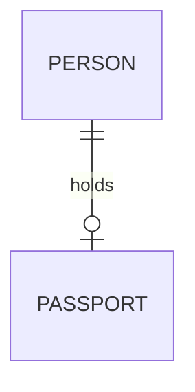
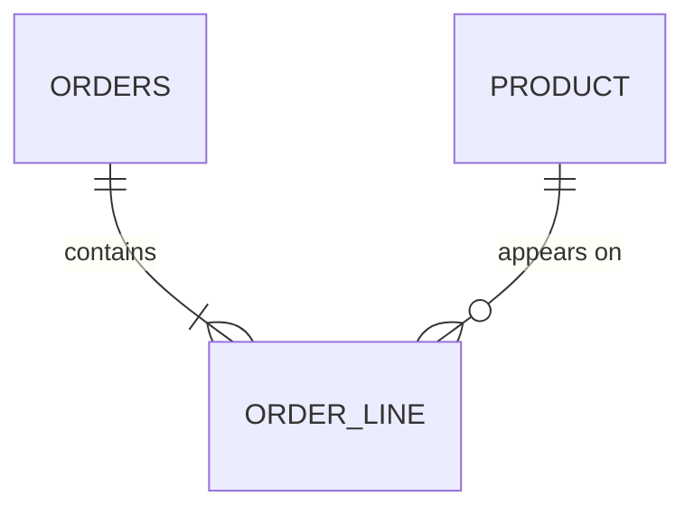
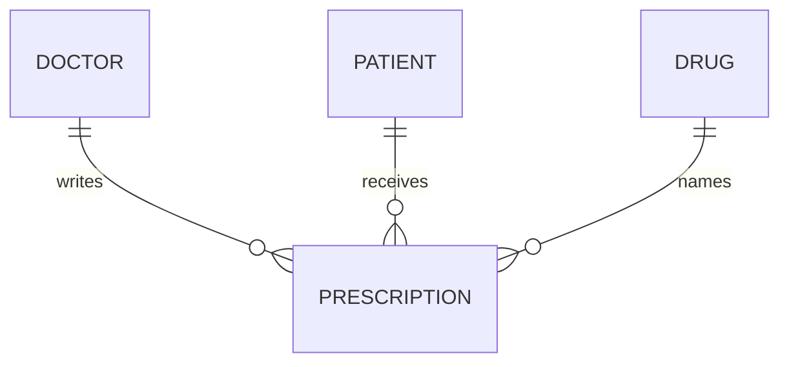
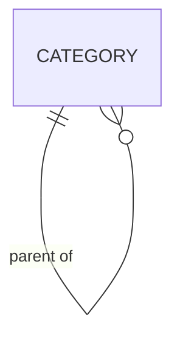
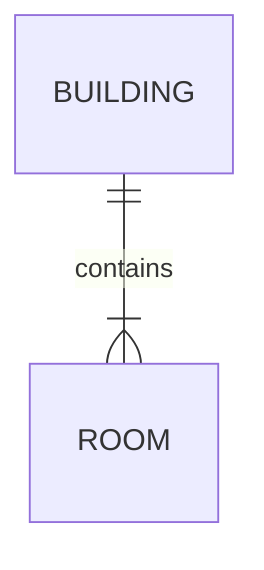
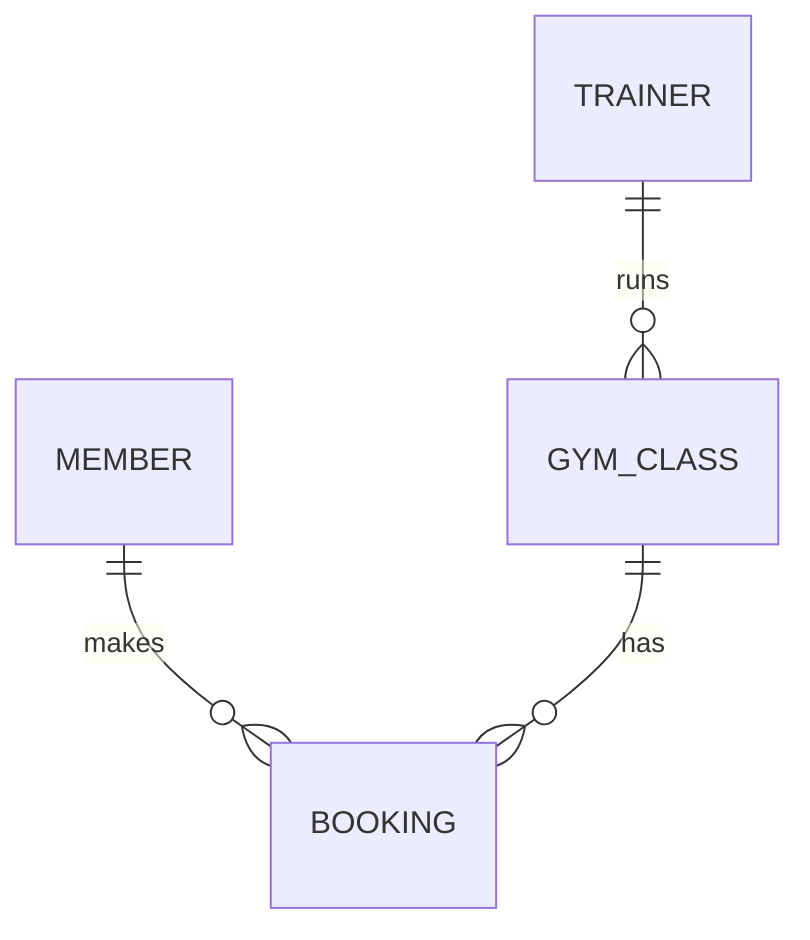

<!--
  FORMAT NOTE
  This file is Markdown. The boxes marked ```mermaid are crow's-foot ER
  diagrams written in Mermaid's erDiagram syntax; a Markdown viewer (or the
  model you hand this to) renders them as real diagrams. The tables with | pipes
  render as grids of sample rows. When you convert this to PDF, keep a renderer
  that understands Mermaid so the diagrams appear as pictures, not code.
-->

# Database Design — Samples (Revised): Tables and ER Diagrams

## About this edition

This is the corrected companion to the revised lesson. It is the "picture book":
every idea is shown as a **real table with sample rows** and as a **crow's-foot
diagram**. It faithfully follows the uploaded samples file (which I could read in
full) and folds in the Task-2 corrections. Anything I changed or added is marked
**[correction]** so you can see exactly what moved.

Corrections applied here: **C1** a note that INTEGER ids and UUIDs are two kinds
of the same surrogate-key idea; **C2** the prescription ternary now decides
whether its natural triple is UNIQUE; **C3** clear "pick the pair-key vs a
surrogate-id bridge when…" guidance; **C4** every good original addition kept
(frozen fact, reserved words, crow's-foot mirroring); **C5** the two ten-step
methods replaced by one pointer to the merged routine in the revised lesson.

## How to read the ER diagrams (crow's-foot in one box)

Each line between two boxes has a symbol at **each end**. Read the symbol at the
*far* end to learn "how many of that thing."

| Symbol | Means |
|--------|-------|
| `\|\|` | exactly one |
| `o\|` | zero or one (optional) |
| `\|{` | one or many |
| `o{` | zero or many (optional, many) |

In Mermaid the two ends are written together, e.g. `||--o{`:

- `A ||--o{ B` → one A has zero-or-many B; each B has exactly one A.
- `A ||--|{ B` → one A has one-or-many B; each B has exactly one A.
- `A }o--o{ B` → many-to-many (both optional).
- `A ||--|| B` → one-to-one.

**[correction] Mirroring note.** The symbols are *mirrored* on the two ends.
`o{` on the right end and `}o` on the left end mean the same thing (zero-or-many);
you read whichever one is nearest the box you are asking about.

## A note on id style (read once)

**[correction C1]** Every sample below uses small INTEGER ids (1, 2, 3) because
they are easy to read while learning. student-panel instead uses a **UUID** (a
long random id) as the primary key, plus a short unique human code (e.g.
`student_code`). These are **the same idea** — a surrogate key the system
invents — in two costumes. When you see `member_id = 1` here and a long random id
in student-panel, that is not a conflict; it is the same decision made two ways.

## A note on reserved words

**[correction C4, kept]** Some words are reserved in SQL — `order`, `group`,
`user` are the common traps. Name tables safely (`orders`, `groups`, `app_user`)
so the database does not mis-read your table name as a command. student-panel
(Postgres) does exactly this.

---

## Lesson 1 — Entity vs attribute

An **entity** is a kind of thing worth its own table. An **attribute** is a
property of it (a column). Test: does it have its *own* facts that others point
at? → entity. Is it just a value *of* something? → attribute.

`member` table (sample rows):

| member_id | full_name     | email              | joined_on  |
|-----------|---------------|--------------------|------------|
| 1         | Ada Lovelace  | ada@example.com    | 2024-01-10 |
| 2         | Alan Turing   | alan@example.com   | 2024-02-02 |

Here `full_name`, `email`, `joined_on` are **attributes** of the **entity**
`member`. "Ada Lovelace" is not a table — it is a value in one row.

## Lesson 2 — Keys: candidate, primary, natural vs surrogate

A **candidate key** uniquely identifies a row. The one you choose is the
**primary key**. A **natural key** is real-world data (an ISBN); a **surrogate
key** is a system-made id with no meaning.

`book` table — `isbn` is a natural candidate key, `book_id` is the surrogate PK:

| book_id (PK) | title                | author       | isbn          |
|--------------|----------------------|--------------|---------------|
| 1            | The Pragmatic Prog.  | Hunt & Thom. | 9780135957059 |
| 2            | Clean Code           | R. C. Martin | 9780132350884 |

**[correction C1]** `book_id` is shown as INT here; student-panel would use a
UUID. Both are surrogate keys. Keeping the natural key too (as `UNIQUE isbn`)
lets you still look a book up by its real-world identifier.

## Lesson 3 — Translating words into a model

A quick habit for turning a sentence into a design:

| In the sentence… | Becomes… |
|------------------|----------|
| a **noun** you keep facts about | an **entity** (table) |
| a **property** of that noun | an **attribute** (column) |
| a **verb** linking two nouns | a **relationship** |

Example: "A **member** *borrows* a **copy** of a **book**; each loan has a
**due date**." → entities `member`, `copy`, `book`; relationship *borrows*
(a `loan`); attribute `due_on`.

## Lesson 4 — Relationships and cardinality

The three shapes, each shown with sample rows and a diagram.

**1:N — one group, many students** (FK on the many side):

`group` table:

| group_id | name    |
|----------|---------|
| 1        | Morning |
| 2        | Evening |

`student` table (FK `group_id` on the many side):

| student_id | full_name | group_id |
|------------|-----------|----------|
| 1          | Ada       | 1        |
| 2          | Alan      | 1        |
| 3          | Grace     | 2        |



"One group has zero-or-many students; each student has exactly one group."

**1:1 — one person, one passport.** FK goes on the side that is never empty,
with `UNIQUE` + `NOT NULL`:

`person`:

| person_id | full_name |
|-----------|-----------|
| 1         | Ada       |
| 2         | Alan      |

`passport` (FK `person_id`, UNIQUE so no person has two):

| passport_id | person_id (UNIQUE) | number    |
|-------------|--------------------|-----------|
| 1           | 1                  | X1234567  |



"One person holds zero-or-one passport; each passport belongs to exactly one
person."

**M:N — students and courses.** Neither side can hold the FK, so a **table in
the middle** carries one FK to each — see Lesson 7.

## Lesson 5 — Referential integrity (no orphans)

Every foreign key must point at a row that exists. If `loan.member_id = 9` but
there is no member 9, that loan is an **orphan**, and the database refuses it.

`loan` with a bad FK (rejected):

| loan_id | member_id | copy_id |
|---------|-----------|---------|
| 1       | 1         | 1       |
| 2       | **9**     | 2       |   ← refused: no member 9 exists

The rule is enforced by the engine, not by hope: declare `member_id` as a foreign
key `REFERENCES member(member_id)` and the insert of loan 2 fails.

## Lesson 6 — Foreign-key placement

The FK lives on the **many** side of a 1:N, and on the **never-empty** side of a
1:1. A quick check: "which row can there be *many* of for one of the other?" —
that row carries the pointer. One group → many students, so `group_id` sits on
`student` (Lesson 4), never the reverse.

## Lesson 7 — The M:N bridge: orders and products

An order contains many products; a product appears on many orders. That M:N is
resolved by a bridge, `order_line`. (Note the table is `orders`, not `order` —
reserved word.)

`orders`:

| order_id | ordered_on | customer_id |
|----------|------------|-------------|
| 1        | 2024-03-01 | 1           |

`product`:

| product_id | name        | list_price |
|------------|-------------|------------|
| 1          | Blue pen    | 1.50       |
| 2          | Red pen     | 1.50       |

`order_line` (the bridge — one row per product on an order):

| order_id | product_id | quantity | unit_price_at_sale |
|----------|------------|----------|--------------------|
| 1        | 1          | 3        | 1.50               |
| 1        | 2          | 2        | 1.20               |



**[correction C4, kept] Frozen fact.** `unit_price_at_sale` is stored on purpose
— it is the price paid *at that moment*. Even if `product.list_price` changes
tomorrow, the old order must still show 1.20. This is *not* a "derive, don't
store" violation; it is a captured historical fact.

**[correction C3] Which key for the bridge?**

- Use the **pair as the key** — `PRIMARY KEY(order_id, product_id)` — when the
  pairing is naturally unique (a product appears at most once per order) and
  nothing else needs to point *at* a line.
- Give the bridge **its own surrogate id** (`order_line_id`) **when** something
  else must reference a single line (e.g. a returns table), **and** keep
  `UNIQUE(order_id, product_id)` so you still cannot list the same product twice
  on one order. Decide this on purpose, not by habit.

## Lesson 8 — Enrolment and course offerings (two valid models)

Students enrol in courses, but a course runs in different semesters. There are
two correct ways to model "the running of a course," and the samples show both.

**Model A — a `teaching` bridge keyed by the natural pair** `(course, semester)`:

`teaching`:

| course_id | semester  | teacher_id |
|-----------|-----------|------------|
| 1         | 2024-Fall | 7          |
| 1         | 2025-Spr. | 9          |

Key = `(course_id, semester)`.

**Model B — a `course_offering` with its own surrogate id** (so enrolments and
timetables can point at *one* offering):

`course_offering`:

| offering_id | course_id | semester  | teacher_id |
|-------------|-----------|-----------|------------|
| 1           | 1         | 2024-Fall | 7          |
| 2           | 1         | 2025-Spr. | 9          |

`enrolment` then references `offering_id`:

| offering_id | student_id | grade |
|-------------|------------|-------|
| 1           | 1          | A     |

**[correction C4] Pick-when.** Choose **Model A** (the pair-key) when the pairing
is naturally unique and nothing else points at it. Choose **Model B** (surrogate
id) when other tables must reference one offering — then keep
`UNIQUE(course_id, semester)` on it. Same rule as the order_line bridge.

## Lesson 9 — Ternary relationships: prescriptions

A fact that genuinely needs **three** things at once. "Doctor D prescribes drug G
to patient P." Dropping any one noun destroys the fact — that is the **disguise
test** (if the sentence is still true after you remove a noun, it was not really
a ternary).

`prescription`:

| prescription_id | doctor_id | patient_id | drug_id | prescribed_on |
|-----------------|-----------|------------|---------|---------------|
| 1               | 7         | 1          | 3       | 2024-03-01    |
| 2               | 7         | 1          | 3       | 2024-06-01    |



**[correction C2] Decide the UNIQUE on purpose.** With its own `prescription_id`,
ask: should the natural triple `(doctor_id, patient_id, drug_id)` be UNIQUE?
Here **no** — the same doctor may prescribe the same drug to the same patient
again later (rows 1 and 2 differ only by date), so the date is part of what makes
each prescription distinct. If repeats were *not* allowed, you would add
`UNIQUE(doctor_id, patient_id, drug_id)`. Either way, make the choice consciously
— exactly as you did for `order_line`.

## Lesson 10 — Self-reference: a category tree

A category can sit inside another category. One table points at itself.

`category`:

| category_id | name        | parent_id |
|-------------|-------------|-----------|
| 1           | Books       | *(null)*  |
| 2           | Fiction     | 1         |
| 3           | Science     | 1         |
| 4           | Physics     | 3         |



`parent_id IS NULL` marks a **root** (Books). Never use `parent, grandparent,
great_grandparent` columns — that caps the depth and repeats the pattern.
student-panel uses exactly this self-reference shape for its group and parameter
trees.

## Lesson 11 — Weak (dependent) entity

A weak entity cannot be identified on its own; it only exists as part of a
parent. An `order_line` is weak — "line 2" means nothing without its order.
Another classic: a building's `room`.

`room` (identified by its building **plus** its own number):

| building_id | room_no | capacity |
|-------------|---------|----------|
| 1           | 101     | 30       |
| 1           | 102     | 25       |
| 2           | 101     | 40       |



Key = `(building_id, room_no)`. Room 101 exists twice — once per building — and
that is correct, because the building is part of its identity.

## Lesson 12 — The five hard patterns, and "the one move"

| Pattern | The fix |
|---------|---------|
| M:N (many-to-many) | a table in the middle (a bridge) |
| a link with its own facts | that link becomes a table |
| a three-way fact (ternary) | a table joining all three |
| 1:1 | usually merge into one table, unless a reason to split |
| self-reference (tree) | one table with a `parent_id` FK to itself |

**The one move:** whenever a relationship is M:N, *has its own facts*, or joins
three or more things, it becomes **a table in the middle**. Learn that one move
and most "hard" designs become routine.

## Lesson 13 — First normal form (1NF): one value per cell

**Broken** — a list stuffed into one cell:

| member_id | full_name | phones               |
|-----------|-----------|----------------------|
| 1         | Ada       | 555-1111, 555-2222   |

You cannot ask "who has 555-2222?" cleanly. **Fix** — one phone per row, in its
own table:

`member`:

| member_id | full_name |
|-----------|-----------|
| 1         | Ada       |

`phone`:

| phone_id | member_id | number    |
|----------|-----------|-----------|
| 1        | 1         | 555-1111  |
| 2        | 1         | 555-2222  |

## Lesson 14 — Second normal form (2NF): the whole key

2NF matters when the key is **composite**. A non-key column must depend on the
*whole* key, not part of it.

**Broken** — `order_line` keyed by `(order_id, product_id)` but carrying
`product_name` (which depends on `product_id` alone):

| order_id | product_id | product_name | quantity |
|----------|------------|--------------|----------|
| 1        | 1          | Blue pen     | 3        |
| 2        | 1          | Blue pen     | 1        |   ← name repeated

**Fix** — move `product_name` to `product`, where it depends on the full key
`product_id`. `order_line` keeps only `quantity` (and the frozen
`unit_price_at_sale`).

## Lesson 15 — Third normal form (3NF): nothing but the key

No non-key column may depend on another non-key column.

**Broken** — `student` carrying its group's name:

| student_id | full_name | group_id | group_name |
|------------|-----------|----------|------------|
| 1          | Ada       | 1        | Morning    |
| 2          | Alan      | 1        | Morning    |   ← update anomaly waiting

`group_name` depends on `group_id`, not on `student_id`. **Fix** — keep
`group_name` only in `group`; `student` holds just the FK `group_id`.

The mnemonic for all three: **"the key, the whole key, and nothing but the key."**

**[correction C5] The design routine.** The samples file and the primer each had
their own ten-step method. They are the same method sliced differently; this
edition replaces both with **one merged, numbered routine** — see **Part 9 of the
revised lesson** (`database-design-revised-lesson.md`). Use that single list.

## Lesson 16 — Derive, don't store (and the one exception)

A value you can recompute from others should **not** be stored — storing it lets
it drift out of step. But a value captured *at a moment in time* is a **frozen
fact** and must be kept.

| Value | Store it? | Why |
|-------|-----------|-----|
| an order's total | **No** — derive | it is just the sum of its lines |
| a student's age | **No** — derive | compute from `born_on` and today |
| `unit_price_at_sale` | **Yes** — store | the price paid then; must not change |
| an invoice's issued amount | **Yes** — store | a legal record of that moment |

The test: *can I always recompute it from data that will not change?* If yes,
derive. If the source can change but this value must not, freeze it.

## Lesson 17 — ON DELETE rules (say the rule as a sentence)

When a parent row is deleted, what happens to its children?

| Rule | Say it aloud | Use when |
|------|--------------|----------|
| `RESTRICT` | "you may not delete a member who still has loans" | the child must not be orphaned or silently lost |
| `CASCADE` | "deleting an order deletes its order lines too" | the children have no life without the parent |
| `SET NULL` | "deleting a teacher leaves the course with no teacher" | the link is optional and may simply become empty |

**[correction C4, kept]** Always read your chosen rule as a plain sentence before
accepting it — the sentence tells you instantly whether it is the behaviour you
want. student-panel leans on `RESTRICT` + soft-delete (an `archived_at` flag)
rather than hard `CASCADE`, so history is never truly lost.

## Lesson 18 — A full worked design: a small gym

Requirement: "Members join the gym. Trainers run classes. A class happens at a
time and has a capacity. Members book a place in a class."

Entities: `member`, `trainer`, `gym_class`, and a booking bridge (M:N member↔
class, with its own fact `booked_on`).

Final tables:

```
member(member_id PK, full_name, email UNIQUE, joined_on)
trainer(trainer_id PK, full_name)
gym_class(class_id PK, title, starts_at, capacity, trainer_id FK -> trainer)
booking(member_id FK -> member, class_id FK -> gym_class, booked_on,
        PRIMARY KEY(member_id, class_id))
```



Reading it: one trainer runs zero-or-many classes; one class has zero-or-many
bookings; one member makes zero-or-many bookings. The `(member_id, class_id)`
key stops a member booking the same class twice. "Capacity" is a plain attribute;
"places left" is **derived** (capacity minus booked rows), so it is *not* stored.

## Lesson 19 — Eight self-check tests

Cover the answers; say yours aloud first.

1. **Is `colour` an entity or an attribute?** → Depends on purpose: an attribute
   when it is just a value; an entity when colours have their own facts others
   share.
2. **Where does the FK go in a 1:N?** → On the **many** side.
3. **Where does the FK go in a 1:1?** → On the **never-empty** side, `UNIQUE` +
   `NOT NULL`.
4. **How do you resolve an M:N?** → A table in the middle (a bridge), one FK to
   each side.
5. **What does `parent_id IS NULL` mean in a tree?** → That row is a **root**
   (no parent).
6. **Which normal form does a comma-separated list in a cell break?** → **1NF**.
7. **Should you store an order's total?** → No — **derive** it. (But *do* store
   `unit_price_at_sale` — a frozen fact.)
8. **Read `MEMBER ||--o{ LOAN`.** → "One member has zero-or-many loans; each loan
   has exactly one member."

## Glossary

See the full glossary in `database-design-revised-lesson.md`. The terms used most
here: **entity** (a table/type), **attribute** (a column), **relationship** (a
verb between entities), **cardinality** (how many on each side), **primary key**
(the chosen unique id), **foreign key** (a pointer to another table's PK, on the
many side), **surrogate key** (a system-made id — INT or UUID), **bridge** (the
table in the middle of an M:N), **referential integrity** (no orphan FKs),
**normalisation** (one fact in one place), **frozen fact** (a value captured at a
moment in time and kept, not re-derived).

---

*End of the revised samples companion. Read alongside
`database-design-revised-lesson.md` (the full lesson), the hands-on
`database-design-practice-lesson.txt`, and the concept bridge
`database-design-companion-lesson.txt`.*
